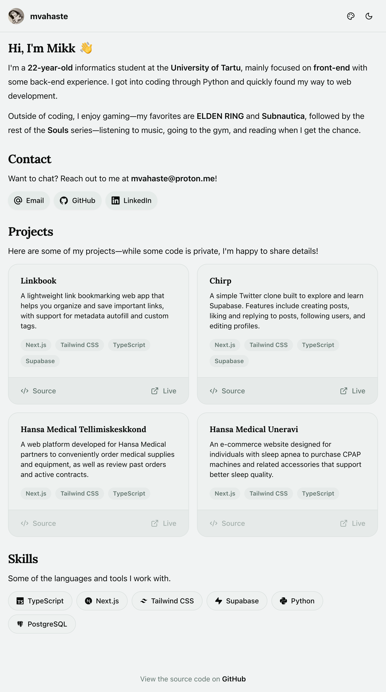
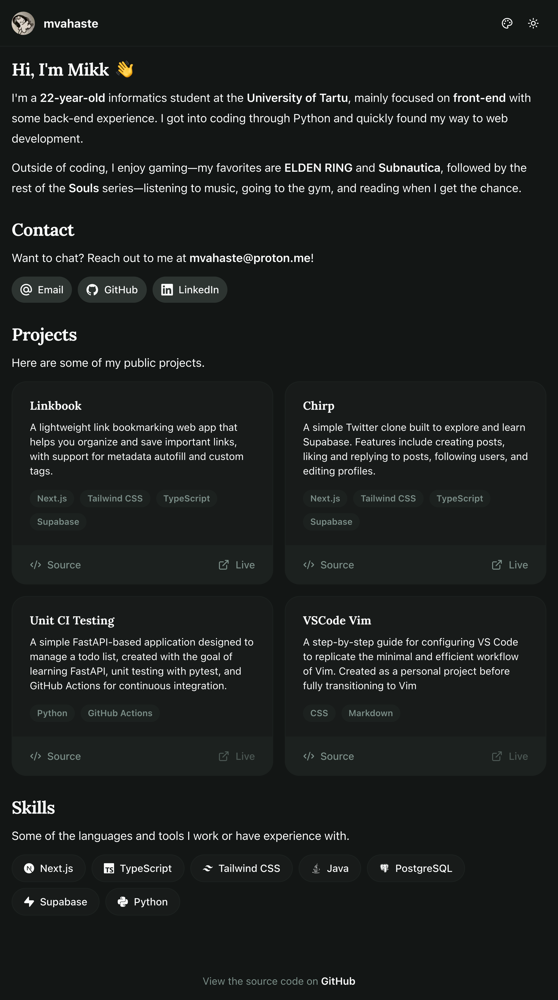
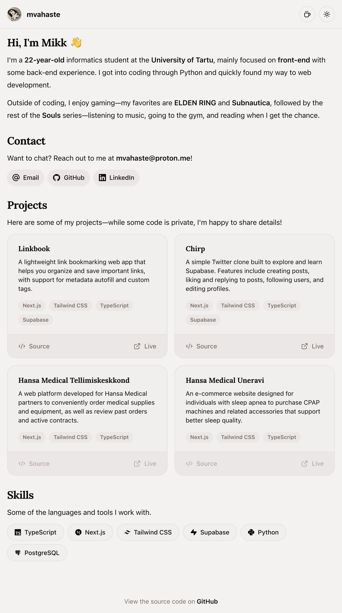
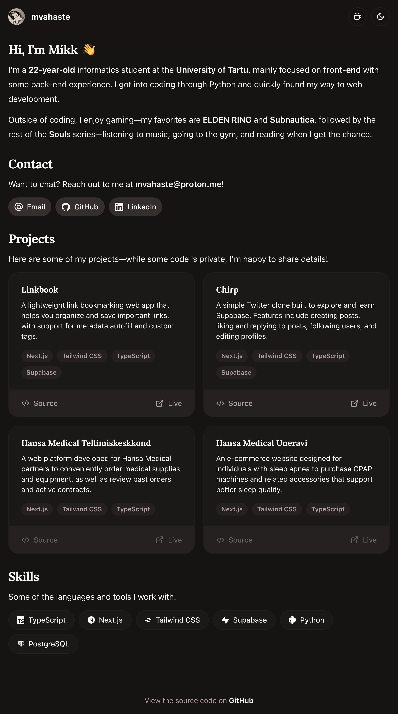

# mvahaste.dev

This is my personal website, hosted at [mvahaste.dev](https://mvahaste.dev). It's designed with a clean, responsive layout and features simple animations for a bit of character. This repository is pretty overkill for what it is, but I enjoy working on it.

## Table of Contents

- [Features](#features)
- [Technologies](#technologies)
- [Installation](#installation)
- [GitHub Actions](#github-actions)
  - [Automatic Favicon and Header Image Updates](#automatic-favicon-and-header-image-updates)
  - [Automatic Screenshot Updates](#automatic-screenshot-updates)
- [Screenshots](#screenshots)
- [License](#license)

## Features

- **Responsive Layout** - The website adapts to different screen sizes.
- **Clean Design** - Simple, elegant design with a soft/pastel colors.
- **Animations** - Staggered fade and slide-in animations on page load, as well as a wave. 👋
- **Color Themes** - Pleasant color themes with light and dark modes.
- **Automatic Favicon Updates** - Website favicon updated automatically alongside my GitHub avatar.
- **Automatic Screenshot Updates** - README screenshots updated automatically on `main` branch pushes.

## Technologies

- [Next.js 15](https://nextjs.org/) - Framework for building the site
- [TailwindCSS](https://tailwindcss.com/) - Styling framework
- [shadcn/ui](https://ui.shadcn.com/) - Base components for the UI
- [Motion](https://motion.dev/) - Library for animations
- [next-mdx-remote](https://github.com/hashicorp/next-mdx-remote) - Render page content from `.md` files
- [Vercel](https://vercel.com/) - Hosting platform
- [GitHub Actions](https://github.com/features/actions) - Automate favicon, header image, and screenshot updates

## Installation

You probably don't need to do this — but just in case, here's how to run the project locally:

1. Clone the repository:
   ```bash
   git clone https://github.com/mvahaste/www.git
   ```
2. Navigate into the project folder:
   ```bash
   cd www
   ```
3. Install dependencies (using `--legacy-peer-deps` due to React 19):
   ```bash
   npm install --legacy-peer-deps
   ```
4. Start the development server:

   ```bash
   npm run dev
   ```

5. For production:
   - Build the project:
     ```bash
     npm run build
     ```
   - Run the production server:
     ```bash
     npm run start
     ```

## GitHub Actions

### Automatic Favicon and Header Image Updates

This repository includes a GitHub Actions workflow that keeps the site's favicon and header image in sync with my GitHub avatar.

#### How It Works

1. **Runs hourly** via a scheduled cron job (`0 * * * *`) or can be triggered manually.
2. Retrieves the latest avatar from my GitHub profile.
3. Compares the fetched avatar with a stored hash to detect changes.
4. If a change is detected, it updates the following files:
   - `.avatar_hash` – stores the hash of the current avatar.
   - `app/favicon.ico` – used as the site’s favicon.
   - `public/images/avatar.png` – used as the header image.
5. Automatically commits and pushes the updated files.

> The GitHub username is sourced from a default environment variable — no hardcoding involved.

#### Relevant Files

- **Workflow**: `.github/workflows/update-favicon.yml`
- **Script**: `scripts/check_avatar.py`
- **Hash File**: `.avatar_hash`

This ensures the site's visuals remain current with my GitHub profile.

### Automatic Screenshot Updates

This repository also includes a GitHub Actions workflow that automatically updates the screenshots in the README to keep them up to date.

#### How It Works

1. **Triggered on every push** to the `main` branch or can be triggered manually.
2. Uses `puppeteer` to capture screenshots of the site with all color themes in both light and dark modes.
3. Saves the screenshots `<theme>-<mode>.png` in the `screenshots/` directory.
4. If any changes are detected, the updated screenshots are committed and pushed automatically.

To prevent infinite loops, the workflow is set to ignore changes to the `screenshots/` directory, as well as a few other files that should not trigger the workflow.

> The repository name, API URL, and access token are all pulled from default environment variables — no hardcoding.

#### Relevant Files

- **Workflow**: `.github/workflows/update-screenshots.yml`
- **Script**: `scripts/update_screenshots.js`

This ensures the README always reflects the latest visual state of the website.

## Screenshots

This is how the website looks with different color themes.

<details>

<summary>Forest</summary>

| Forest Light                                             | Forest Dark                                            |
| -------------------------------------------------------- | ------------------------------------------------------ |
|  |  |

</details>

<details>

<summary>Coffee</summary>

| Coffee Light                                             | Coffee Dark                                            |
| -------------------------------------------------------- | ------------------------------------------------------ |
|  |  |

</details>

## License

This project is licensed under the MIT License.
